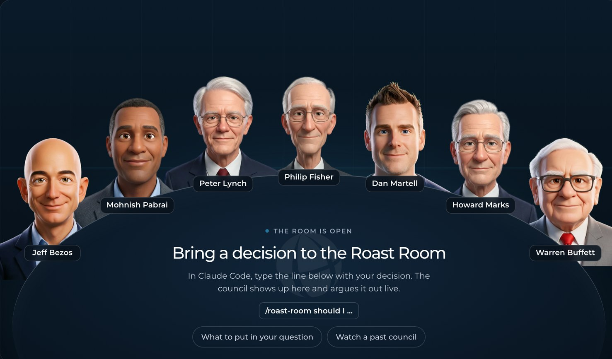

# Roast Room



Bring a hard business decision and seven AI advisors argue it out, then hand you a scored verdict and a one-click PDF. The seats are Jeff Bezos, Mohnish Pabrai, Peter Lynch, Philip Fisher, Dan Martell, Howard Marks, and Warren Buffett, each built from that person's public work: their letters, essays, talks, and videos. The council runs in Claude Code, and a small local web app shows them around a table talking it through.

| Seat | Pillar | The question they own |
|---|---|---|
| Jeff Bezos | Strategy and decisions | Is this the right bet, and how reversible is it? |
| Mohnish Pabrai | Asymmetric bets and risk | Is the downside small, and has someone already proven this works? |
| Peter Lynch | Business knowledge and homework | Does the founder know this business, and has the homework been done? |
| Philip Fisher | Management and long-term growth quality | Can this team be trusted, and can the business keep growing for years? |
| Dan Martell | People, hiring, and founder time | Who does this, and what does it cost your calendar? |
| Howard Marks | Cycles and second-level thinking | Where are we in the cycle, and what does everyone already believe that may be wrong? |
| Warren Buffett | Money and capital | What does it do to cash, risk, and long-term value? |

## What you need

- [Claude Code](https://claude.com/claude-code). Your Claude plan covers it; no API key needed.
- [Node.js](https://nodejs.org) 20 or newer, for the room. There's nothing to install beyond that.

## Setup

```bash
git clone https://github.com/nateherkai/roast-room.git
cd roast-room
```

Or open Claude Code anywhere and say: "Clone github.com/nateherkai/roast-room and start the room for me."

## Run a roast

1. Start the room: `npm start`, then open http://localhost:4730. Leave it open.
2. Open Claude Code in the same folder: `claude`
3. Type `/roast-room` and your decision.
4. Answer the Chair's questions, then watch the council argue it out in the room.
5. When the verdict lands, click **Download PDF**.

You also get a short verdict in Claude Code, and the full report lands in `sessions/<date>-<decision>/verdict.md`.

## What to put in your question

The council is only as good as what you give it. Include:

- **The decision** in one line.
- **Your options, if you have them.** Two or three. "Keep doing what I do now" counts. No options yet? Leave them out and the advisors propose some first (see "No options" below).
- **Your numbers.** Revenue, cash, and team size.
- **Your limits.** Deadline, hours, and budget.
- **What success looks like**, and by when.
- **Which way you're leaning**, and why. The council tests your lean instead of agreeing with it.

Left something out? The Chair asks before the council starts. Example:

```
/roast-room I run a coaching business at $30k a month with 15 clients at $2,000 each.
Should I raise to $3,500 for everyone, raise for new clients only, or keep $2,000?
Close rate is about 50% and I have $40k in the bank. Success is $45k a month by March.
I'm leaning toward raising for everyone because I'm underpaid.
```

## No options? The council starts with Round 0

You don't have to know your options. Ask an open question ("what should I do about churn?") or name one idea ("should I hire a CFO?") and the council opens with a short **Round 0**. Every advisor proposes three plausible options, including one they wouldn't pick themselves, and doesn't say which they favor. The Chair merges them into a list of three to five: your own idea stays on it, and "keep doing what I do now" is always added. Then the usual rounds debate and score that list. The room shows Round 0 as its own step, with who proposed what.

```
/roast-room My newsletter has been stuck at 4,000 subscribers for six months and earns $2k a month
from sponsors. I have about 6 hours a week and $5k. What should I do next?
```

More ways to run it:

- `/roast-room --quick ...` seats four advisors for two rounds. Use it for smaller, reversible calls. It uses far less of your plan.
- `/roast-room --seats lynch,buffett ...` seats only the advisors you name.
- `/roast-room ask lynch ...` gets one answer from one seat.

The room is optional. The council runs the same in Claude Code without it.

## Watch an example first

Run `npm start`, open http://localhost:4730, and click **Past sessions**. Three finished councils ship with the repo, so you can see how it works (and download their PDFs) before you run your own.

## How it works

- **The council runs in Claude Code.** Each seat is a sub-agent (`.claude/agents/council-*.md`) that reads its own brain (`.claude/skills/roast-room/brains/<name>/`): frameworks, principles, positions, stories, and voice notes compiled from public sources, with every quote tied to a source. Claude Code acts as the Chair. It runs the rounds, keeps score, and writes the verdict (`.claude/skills/roast-room/SKILL.md`).
- **Each seat scores every option**, weighted by how much that seat's pillar matters to your decision. The Chair caps the verdict when a seat flags ruin risk, and it forces a real argument when everyone agrees too fast.
- **The room only watches.** As the Chair works, it writes each step to `sessions/`, and the app plays those files back. Between rounds it shows which round is running, how long it has been, and what each advisor is weighing. The room makes no AI calls of its own.
- **Every council is saved** in `sessions/`. Past sessions replays any of them and downloads its PDF.
- **Usage:** a full council is 21 sub-agent runs (28 when you leave out your options, because the advisors propose them first), so it takes a real bite out of your plan's usage. Use `--quick` for small calls.

## Optional: let the room run councils itself

If you'd rather type a decision straight into the room, copy `.env.example` to `.env`, add an `ANTHROPIC_API_KEY`, set `COUNCIL_RUNNER=api`, and restart `npm start`. That mode bills your Anthropic API account (about 25 calls per full council).

## Add your own advisor

The `/new-seat` skill builds a new seat from a person's name:

```
/new-seat Peter Lynch
/new-seat Mohnish Pabrai --key pabrai
```

It does these things in order:

1. **Scopes the seat.** It picks a short key, a slug, a pillar the person is a real operator in (one the roster does not already cover), the dimension the seat scores on, and a color. It asks only when the name is ambiguous or the pillar is a real choice.
2. **Builds a corpus** of the person's public work (essays, letters, long talks, long interviews), with a source id on each file. Aim for 40 or more sources; 25 is the floor, and a thinner brain is marked as thin.
3. **Writes the brain** to `.claude/skills/roast-room/brains/<slug>/`: `sources.md`, `frameworks.md`, `principles.md`, `positions.md`, `stories.md`, `books.md`, `voice.md`, and the one-page `_hot.md`. Every quote is verbatim from a fetched source and tied to its id.
4. **Writes the agent** to `.claude/agents/council-<key>.md`.
5. **Checks the work** with `python3 .claude/skills/new-seat/scripts/check_brain.py <slug> --corpus <folder>`, which fails on a missing file or section, an unknown source id, a quote that is not in its source, or an em dash.
6. **Writes the portrait prompts.** You get four Gemini image prompts (base, open, mid, blink) in `docs/portraits/<key>-prompts.md`. The base prompt says the image should look like the person, and the other three edit the base, so the frames line up. The skill also prints the `cwebp` commands for the finished frames.

Then it offers to register the seat. That adds the entry to `app/lib/seats.mjs` and the row to `.claude/skills/roast-room/references/seats.md`, and updates any text that says "seven" advisors. Save your four frames as `app/public/portraits/<key>-base|open|mid|blink.webp`. The room will not show the seat until it is registered and the frames are in place.

The roster ships with seven seats, and the docs and the table layout assume seven. The usual move is to swap: tell the skill which advisor to replace, then delete that advisor's agent, brain, and portraits. Adding an eighth seat has not been tried.

## What's inside

| Path | What |
|---|---|
| `.claude/skills/roast-room/` | The skill: protocol, prompts, scoring, report template, and the seven brains |
| `.claude/skills/new-seat/` | The skill that builds a new advisor: brain, agent, and portrait prompts |
| `.claude/agents/` | The seven seat agents |
| `app/` | The room: a zero-dependency Node server, the web page, and the PDF builder |
| `sessions/` | Your councils (kept out of git) and the three examples |

## About the advisors

These are simulations built from each person's public work. They are not the people, they don't speak for them, and none of them is affiliated with or endorses this project. A seat only quotes a person verbatim when the line is in its brain with a source, and `python .claude/skills/roast-room/scripts/check_quotes.py sessions/<session>` checks every quote in a council against the brains. Each brain's `sources.md` lists what it was built from.

Built by AI Automation Society. The code is MIT licensed; see `LICENSE`. The PDF builder bundles [jsPDF](https://github.com/parallax/jsPDF) (MIT) and [Montserrat](https://github.com/JulietaUla/Montserrat) (SIL Open Font License); their licenses sit next to them in `app/public/`.
